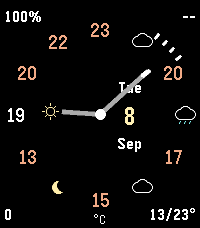
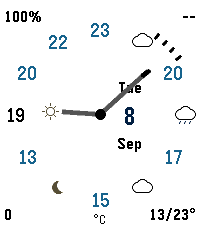
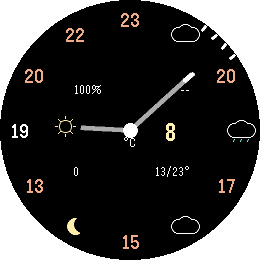
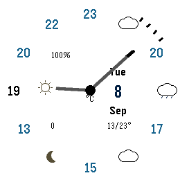

# Crisp Weather

An analog Pebble watchface with an hourly weather forecast around the dial.
Based on [Michal Bláha’s Crisp](https://github.com/michalblaha/Crisp-watchface), it keeps the two-tone hands, themes, date, and configurable corner readouts.

| Watch shape | Dark theme | Light theme |
| --- | --- | --- |
| Rectangular (emery) |  |  |
| Round (gabbro) |  |  |

*v0.2.0 emulator previews with illustrative weather data and the updated light palette.*

## Features

- Read the forecast clockwise from the current hour, covering up to the next 11 hours.
  Some trailing positions remain hour ticks for readability.
- See the current hour’s temperature on the dial and its weather icon at the hour-hand tip.
  Future hours show an icon when conditions change, otherwise a temperature.
- Customize themes, forecast colors on color watches, corner readouts, temperature units, and Bluetooth disconnect alerts.
  Light mode uses dark tick marks, dark blue forecast numbers, and dark weather accents.
- Get weather from the preferred Pebble weather plugin and select a saved Pebble weather location.
  Keep Crisp's forecast dial, condition artwork, temperature units, and low/high readout.

Weather is an hourly forecast, not a live observation.
The watchface shows the original Crisp dial until weather arrives.
Plugin forecasts expire at the source deadline or after three hours, whichever comes first.
A source without a deadline is valid for 30 minutes.
Missing hourly temperatures appear as ticks.
Missing conditions use an unknown icon.
Daily temperatures and rain can arrive independently.
Daily temperatures expire at the forecast day's end; rain expires at its forecast hour's end.

The phone saves weather before Bluetooth delivery and retries delivery without another source subscription.
Plugin replay keeps the original timestamps and expiry.
Permission denial clears plugin weather; it does not switch to another backend.

Targets: aplite, basalt, chalk, diorite, emery, flint, and gabbro.
Crisp Weather can be installed alongside the original Crisp.

This is an early version.
Plugin payloads, expiry, settings, and layouts have automated or emulator checks.
Live plugin delivery, phone background behavior, and Bluetooth recovery still need physical hardware checks.

## Build and develop

Install Node.js, npm, [Pebble SDK](https://developer.repebble.com/sdk/) 4.44 or later, and pebble-tool 5.1.0 or later, then run:

```sh
npm install
npm test
npm run test:native
pebble build
npm run test:bundle
pebble install --emulator emery
```

The watchface bundle is written to `build/crisp-weather.pbw`.

- `src/c/`: watchface rendering, settings, and forecast cache.
- `src/pkjs/`: phone-side plugin subscriptions, forecast parsing, and settings UI.
- `tests/`: JavaScript tests and native C tests.

Tests cover partial responses, component expiry, settings migration, restarts, clock changes, timeouts, and failed delivery.
The native tests need a C compiler and Python 3.
The bundle check uses the built JavaScript, real Clay settings, and simulated phone and plugin services.

For a reproducible emulator preview, run `python scripts/preview.py emery dark` (or `light`) in the Python environment containing `pebble-tool`.
The script installs a preview bundle with phone requests disabled, sets the emulator clock, and supplies fixture weather data.
Run `python scripts/preview.py --all` to update both themes on all platforms.
Use `--partial --output /tmp/crisp-partial.png` to inspect missing forecast data.

See [UPSTREAM.md](UPSTREAM.md) for source attribution and the imported revision.

## Plugin preview

This branch needs Pebble SDK 4.44 or later and pebble-tool 5.1.0 or later.
Enable Settings → Plugins → Plugins / permissions preview in the Pebble mobile app.
Plugins are not ready for general Appstore release.
See the [Pebble plugin guide](https://developer.repebble.com/guides/plugins/preview/).

Each corner can show a local watch reading, a plugin reading, or the next available reading from your preferred Pebble complications.
The plugin picker lists text, number, and timestamp readings from installed plugins.
It uses the preferred provider for each source in the Pebble app.
Select an instance to keep a specific location or device, or use the first instance to follow the source order.
The settings page previews the selected reading.
If a source is slow or unavailable, the page retries and keeps the selected instance.
Permissions for selected sources are handled by the Pebble app.

Plugin text is limited to seven characters and 28 UTF-8 bytes.
Long text can show an ellipsis in narrow layouts.
Timestamps use the phone's local time in 24-hour format.
Automatic corners retain the last preference order and valid readings across restarts.
Fresh preferences replace that order, and permission denial clears the affected cached readings.
Cached readings keep their original expiry; a reading with no expiry lasts five minutes, and no reading is retained for more than one day.
Expired or missing readings show `--`.
Watch battery, Bluetooth, steps, and heart rate remain local and work without the phone.
Existing corner settings are preserved.

### Weather plugins

Weather comes from Pebble plugins.
Select a location under Weather location in the watchface settings.
The first-location option follows the location order in the Pebble app; a named location keeps its stable identifier.
Configure weather locations and preferred providers in the Pebble app.
The face subscribes to `weather/location` and converts its series to the existing compact forecast format.
It does not make direct HTTP or geolocation requests.
The manifest keeps Location permission for weather sources and Health permission for local watch readings.

Hourly temperatures require a timed numeric series in Celsius or Fahrenheit.
Missing temperatures remain empty ticks, and unknown conditions use the unknown icon.
Daily low/high and rain chance can work without hourly temperatures.
The rain readout uses the source's current precipitation chance, not rainfall amount.
A removed location clears the weather instead of selecting another place.
Changing plugin locations clears the old weather before showing new data.

Upgrades remove the old Open-Meteo settings, saved coordinates, forecast cache, and request history.
Existing plugin locations and corner settings are preserved.
Use `python scripts/preview.py emery --plugins --output /tmp/crisp-plugins.png` to capture fixture corner readings.
