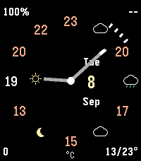
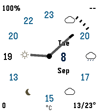
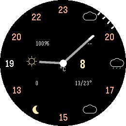
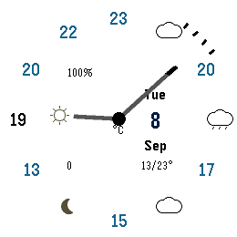

# Crisp Weather

An analog Pebble watchface with an hourly weather forecast around the dial.
Based on [Michal Bláha’s Crisp](https://github.com/michalblaha/Crisp-watchface), it keeps the two-tone hands, themes, date, and configurable corner readouts.

| Watch shape | Dark theme | Light theme |
| --- | --- | --- |
| Rectangular (emery) |  |  |
| Round (gabbro) |  |  |

*v0.2.0 emulator previews with illustrative weather data and the updated light palette.*

## Features

- Read the forecast clockwise from the current hour, covering up to the next 11 hours.
  Some trailing positions remain hour ticks for readability.
- See the current hour’s temperature on the dial and its weather icon at the hour-hand tip.
  Future hours show an icon when conditions change, otherwise a temperature.
- Customize themes, forecast colors on color watches, corner readouts, temperature units, and Bluetooth disconnect alerts.
  Light mode uses dark tick marks, dark blue forecast numbers, and dark weather accents.
- Get weather from [Open-Meteo](https://open-meteo.com/) through your phone every 30 minutes, with no API key.
  Use phone location permission or set manual coordinates in settings.
  Internet access is required.

Weather is an hourly forecast, not a live observation.
The watchface shows the original Crisp dial until weather arrives, and returns to it after three hours without a fresh forecast.
Missing hourly temperatures appear as ticks.
Missing conditions use an unknown icon.
Daily temperatures and rain can arrive independently.
Daily temperatures expire at the forecast day's end; rain expires at its forecast hour's end.

The phone saves weather before Bluetooth delivery and retries delivery without another API request.
Network failures use increasing retry delays; HTTP 429 starts a saved cooldown and respects `Retry-After`.
Requests are limited to one per minute, six per rolling hour, and 96 per rolling day per installation.
These local limits do not replace [Open-Meteo's shared limits](https://open-meteo.com/en/terms).
Restarting the face or reconnecting the watch does not reset request limits.
If request history cannot be stored, HTTP requests stop to protect the request budget.
Settings show location errors, the last successful fetch, forecast age, and the next allowed request.
A saved phone location can be used for up to six hours when a new fix times out or is unavailable.

Targets: aplite, basalt, chalk, diorite, emery, flint, and gabbro.
Crisp Weather can be installed alongside the original Crisp.

This is an early version.
Live weather delivery has been checked in the emulator.
Phone background behavior and Bluetooth recovery still need physical hardware checks.

## Build and develop

Install Node.js, npm, and the [Pebble SDK](https://developer.repebble.com/sdk/), then run:

```sh
npm install
npm test
npm run test:native
pebble build
npm run test:bundle
pebble install --emulator emery
```

The watchface bundle is written to `build/crisp-weather.pbw`.

- `src/c/`: watchface rendering, settings, and forecast cache.
- `src/pkjs/`: phone-side weather requests, forecast parsing, and settings UI.
- `tests/`: JavaScript tests and native C tests.

Tests cover partial responses, component expiry, rate limits, restarts, clock changes, timeouts, and failed delivery.
The native tests need a C compiler and Python 3.
The bundle check uses the built JavaScript, real Clay settings, and simulated phone services.

For a reproducible emulator preview, run `python scripts/preview.py emery dark` (or `light`) in the Python environment containing `pebble-tool`.
The script installs a preview bundle with phone requests disabled, sets the emulator clock, and supplies fixture weather data.
Run `python scripts/preview.py --all` to update both themes on all platforms.
Use `--partial --output /tmp/crisp-partial.png` to inspect missing forecast data.

See [UPSTREAM.md](UPSTREAM.md) for source attribution and the imported revision.
